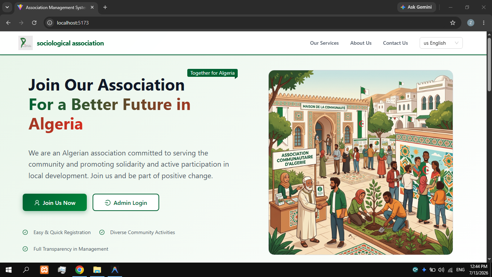
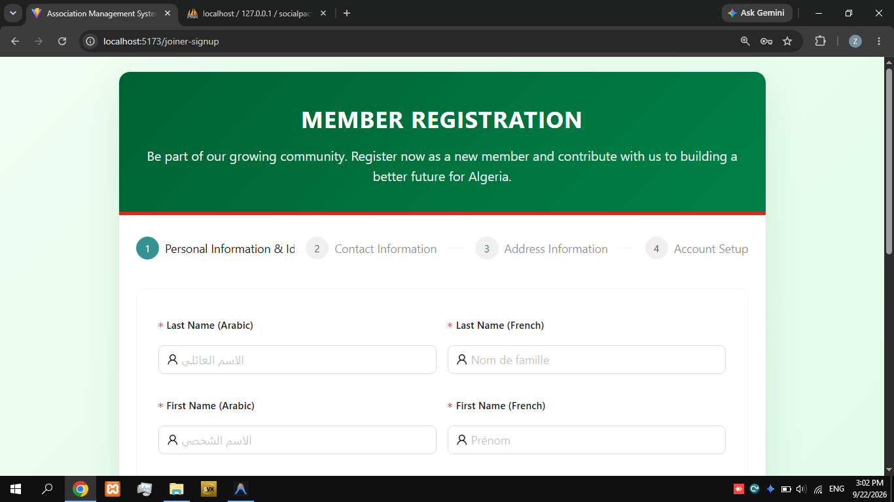
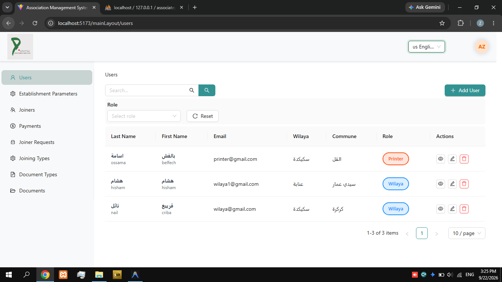
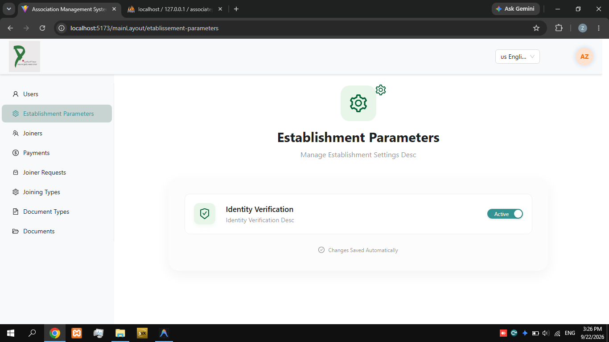
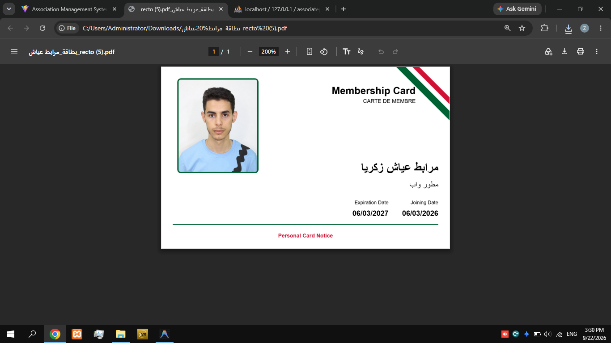

# Association Management System

**Association Management System** is a full-stack web application designed to help associations in Algeria manage their members, staff, events, projects, and internal operations — all from one centralised platform.

## Why I Built It

Associations often rely on paper-based processes or generic tools that don't fit their structure. This project was built to give associations a dedicated digital space where admins can manage their organisation, and members can register and stay connected.

The application is built with Algeria's administrative geography in mind — supporting Wilayas, Communes, and Etablissements — and offers full multilingual support in **Arabic**, **French**, and **English** with RTL layout for Arabic.

## Features

- Public landing page with association branding, services, and statistics
- Multilingual support (Arabic 🇩🇿, French 🇫🇷, English 🇺🇸) with RTL layout
- Member self-registration and login portal
- Role-based access control (Admin, Manager, Parent, Associate)
- Geographical structure: Wilaya → Commune → Etablissement
- User management with Arabic and French name support
- Role-specific dashboards
- Dynamic association branding (logo, name, contact info)
- REST API with Laravel Sanctum authentication

## Screenshots

Landing page and dashboard views — screenshots taken from the live application







## Tech Stack

- **Frontend**: React (Vite), Ant Design, React Router, Context API
- **Backend**: Laravel (PHP), Laravel Sanctum
- **Database**: MySQL / PostgreSQL
- **Styling**: Tailwind CSS + custom CSS
- **Internationalisation**: Custom i18n with AR / FR / EN support

Key packages:

- `frontend`: `react`, `antd`, `react-router-dom`, `vite`, `tailwindcss`
- `backend`: `laravel/framework`, `laravel/sanctum`

## Installation (local)

Prerequisites:

- PHP 8.1+
- Node.js 16+
- Composer
- MySQL or PostgreSQL

### Backend setup

```bash
cd backend
composer install
cp .env.example .env
php artisan key:generate
```

Configure your database in `.env`:

```env
DB_CONNECTION=mysql
DB_HOST=127.0.0.1
DB_PORT=3306
DB_DATABASE=association_db
DB_USERNAME=your_username
DB_PASSWORD=your_password
```

Then run migrations and seed sample data:

```bash
php artisan migrate
php artisan db:seed
php artisan serve
```

### Frontend setup

```bash
cd frontend
npm install
npm run dev
# open http://localhost:5173
```

## Environment Variables

Backend — create a `backend/.env` (copy from `.env.example`):

- `APP_KEY` — generated by `php artisan key:generate`
- `DB_*` — database connection settings
- `SANCTUM_STATEFUL_DOMAINS` — frontend domain (e.g. `localhost:5173`)

Frontend — create a `frontend/.env` (copy from `.env.example`):

- `VITE_API_BASE_URL` — full URL to the backend (e.g. `http://localhost:8000`)

## Default Login Credentials

After running the seeder:

| Role      | Email                       | Password    |
|-----------|-----------------------------|-------------|
| Admin     | admin@association.com       | password123 |
| Manager   | manager@association.com     | password123 |
| Parent    | parent1@association.com     | password123 |
| Associate | associate1@association.com  | password123 |

## User Roles

| Role      | Access Level                                                       |
|-----------|--------------------------------------------------------------------|
| Admin     | Full system access — all centres, all users, system configuration  |
| Manager   | Centre-level management — parents and associates in their centre   |
| Parent    | View child info, schedules, and centre communications              |
| Associate | Childcare operations — assigned children and daily activities      |

## Project Structure

```
association/
├── backend/
│   ├── app/
│   │   ├── Http/Controllers/Api/
│   │   ├── Models/
│   │   └── Http/Requests/
│   ├── database/
│   │   ├── migrations/
│   │   └── seeders/
│   └── routes/
└── frontend/
    └── src/
        └── assets/
            ├── views/          # Page components (Landing, Dashboard, etc.)
            ├── auth/           # Login and registration
            ├── layout/         # Navigation and layout components
            ├── locale/         # i18n translations (AR, FR, EN)
            ├── services/       # API service layer
            └── components/     # Shared UI components
```

## API Endpoints

### Authentication
- `POST /api/login` — User login
- `POST /api/logout` — User logout

### Users
- `GET /api/users/{user_id}` — List users (role-filtered)
- `POST /api/users` — Create new user
- `GET /api/users/{id}` — Get user details
- `PUT /api/users/{id}` — Update user
- `DELETE /api/users/{id}` — Delete user

### Geographical Data
- `GET /api/wilayas` — List wilayas
- `GET /api/communes` — List communes
- `GET /api/etablissements` — List etablissements

## .gitignore Notes

The following are excluded from version control:

- `frontend/node_modules/` and `backend/vendor/`
- `frontend/dist/` (production build output)
- All `.env` files except `.env.example` files
- Laravel storage caches (`debugbar`, `logs`, `framework/cache`, `sessions`, `views`)
- Generated SSL/key files (`backend/storage/*.key`)
- Log files (`*.log`, `npm-debug.log*`)
- OS/IDE files (`.DS_Store`, `.idea/`, `.vscode/`)

## Support

For technical support or questions about the system, refer to the documentation or contact the development team.